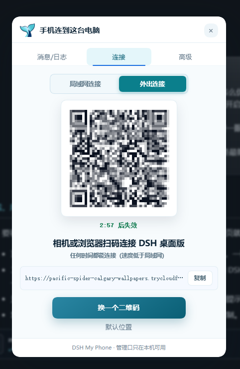
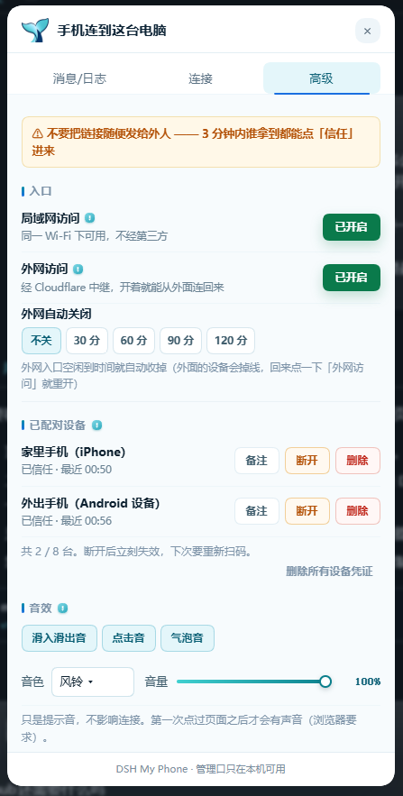
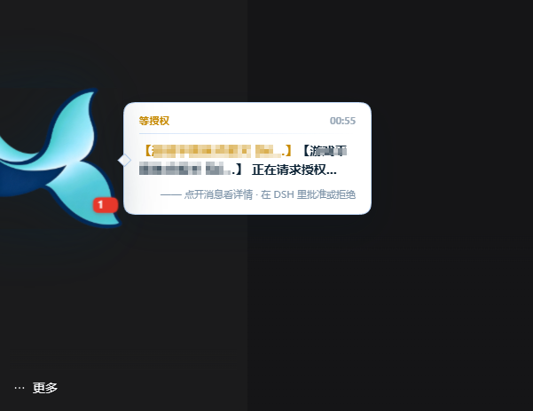

# DSH My Phone

> **把家里电脑上的 DSH，装进口袋。** 手机扫码即可继续对话，不用安装 App，也不注册账号。

> ## 🚨 开启前必读
> **打开这个入口，等于把这台电脑上的 DSH 账号密码贴在门框上。**
> 任何拿到入口的人都能以你的身份读文件、跑命令、看全部对话。
> **局域网入口默认打开（装好就能用），用不到时请关掉；外网隧道默认关闭。**
> 完整风险清单见 [SECURITY.md](./SECURITY.md)。

---

## 它解决什么

人在公司，DSH 在家里电脑上。想接着问两句，不用远程桌面、不用 VNC、不用装客户端——
手机上打开一个网页，看到的就是**原生 DSH 界面**。

```
手机浏览器 ──▶ DSH My Phone（配对凭据）──▶ 本机 DSH（官方会话）
```

- **手机端零安装**：打开网页就是完整界面
- **支持局域网**（同 Wi-Fi，不经第三方，最安全）
- **支持外网**（Cloudflare 隧道，公司/外地可用）
- **一台设备一份凭据**，可单独移除
- **更新记录**：[CHANGELOG.md](./CHANGELOG.md)（一版一行）

## 快速开始

```bash
# 1. 装进当前 profile
dsh plugin add ./dsh-my-phone --profile desktop

# 2. 重启 DSH，打开设置页
#    http://127.0.0.1:8080/__myphone/   （只能在本机打开）
```

1. 打开设置页，点一下「**生成二维码**」（二维码不会自动生成，需要你点一下；屏幕上有码才说明它是「刚生成的」）
2. 手机扫码 → 手机上出现「**信任这台电脑？**」→ 点「信任这台电脑，进入 DSH」
3. 完成。之后手机直接打开那个地址就行

> 二维码里带的是**一次性票据**（3 分钟、用一次就作废），比手输 6 位码更难被猜到。
> 它**不会自动刷新**：3 分钟到了就失效，想连就再点一次「换一个二维码」。
> 手输已取消 —— 手机端只看得到「扫码」这一条路；电脑端也没有 6 位码了。

在 DSH 的任意界面**右下角**都有一个悬浮图标（图标 + 一行「连接 DSH」字），点开就是同一个二维码，不用去翻设置页。
连上以后那行字会自动消失；鼠标放上去会轻轻弹一下，按住可以拖着贴到任意一条边。

### 外网（在公司用家里电脑）

1. 第一次开启时插件会自己在后台下载 `cloudflared`（约 53MB，有进度，只下一次）
2. 等 10~30 秒出现 `https://xxx.trycloudflare.com`
3. 手机打开这个地址（或直接扫二维码），点一次「信任这台电脑」

> ⚠️ **快速隧道的地址每次重启都会变**。变了你需要重新打开电脑上的设置页看一眼新地址。
> 想要固定地址，需要自己的域名 + Cloudflare 命名隧道（v0.2 支持）。

## 界面

手机上只有三个页签：**消息/日志 / 连接 / 高级**，电脑上点右下角悬浮图标弹出同一套面板。

| 「连接」页 | 「高级」页 |
|---|---|
|  |  |
| 局域网 / 外出两张码可切换，默认给局域网那张；只开一个入口就只出一张码 | 入口开关、已配对设备（可备注 / 断开 / 删除）、音效设置 |

| 气泡提醒（授权 / 超时） |
|---|
|  |

会话需要你批准、或者一轮跑太久没结束，悬浮球旁边会自己弹一条气泡，同时响一声；点球打开「消息/日志」看详情。
同类事件短时间内不会重复弹（去抖），不会一直吵。

## 配置

状态存在 `~/.dsh/.dsh-my-phone/state.json`：

| 字段 | 默认 | 说明 |
|---|---|---|
| `lanEnabled` | `true` | 局域网入口（装好即可用；不用时请关掉） |
| `lanPort` | `8080` | 管理页端口（仅 127.0.0.1；被占用时自动往后试 12 个端口） |
| `publicPort` | `8081` | 公网入口端口（仅在开启时监听，同样自动避让） |
| `tunnelEnabled` | `true` | 外网隧道（手机不在同一 WiFi 时才有用；不用请关掉） |
| `cloudflaredPath` | `''` | cloudflared 可执行文件路径 |
| `maxDevices` | `8` | 最多可配对设备数 |
| `autoOffMinutes` | `30` | 连续多久没有访问就自动收回入口，`0` = 不自动关 |

> 这个文件含本机签名密钥，**等同于密码，不要外传**。

## 安全设计（三条原则）

1. **不碰密钥文件**。插件不解析 `.credentials.yaml`，而是调用宿主官方
   `ctx.connection.authenticatedUrl()` 换一枚官方会话。宿主改版也炸不了。
2. **管理面与访问面物理分离**。管理页只绑 `127.0.0.1`，公网监听器收到该路径直接 404。
3. **凭据可吊销**。一台设备一枚 HMAC 令牌，删掉设备立刻失效，不需要换全局口令。

详见 [SECURITY.md](./SECURITY.md)，含逐环节攻击面与 12 项实测结果。

## 已知限制（v1.5.0）

- ❌ 隧道断线不自动重连
- ❌ 快速隧道地址不固定
- ❌ 手机端不能自动锁横屏（浏览器限制：只有全屏 + 系统允许时才让锁方向，iOS 基本不行）——提供「全屏横屏」按钮试一次，失败就手动转手机
- ✅ 右下角悬浮按钮（`shell.overlay` 插槽）做成**手机 App 图标的样子**：60px 白圆角方块（里面一条鲸尾）+ 下面一行胶囊字「连接 DSH」
  - **连上（有设备被信任）以后那行字自动消失**，只剩图标；没连上就一直挂着，随时提醒你它还开着
  - 鼠标悬停 0.3 秒 / 长按 0.42 秒 → 一个**只展示不带按钮**的气泡，几秒后自己消失；**点一下 = 打开弹窗**（电脑和手机上完全一致）
  - 悬停/按下的形变更大也更 Q 弹：`cubic-bezier(.34,1.56,.64,1)` 回弹，hover 抬起 7px + 放大 1.14 + 微转，press 压到 0.86 再弹回；系统开了「减少动态效果」就自动关掉
  - **可以拖着走，松手贴最近的一条边（上/下/左/右都行）**；位置记成「贴哪条边 + 该方向上的偏移」（不是绝对坐标），
    所以窗口缩放、父容器有 transform 都不会算歪；弹窗右下角有一行纯文字的「回到图标默认位置」（无背景无边框，悬停变蓝），点完顺手把弹窗关掉
  - `z-index: 2147483000`（弹窗 2147483200）：别的插件的浮球/浮层压不住它
  - 默认位置＝贴右边、离底边四个图标的高度（≈400px），不压右下角那一排常用按钮
  - 图标用插件自己的 `icon.png`（透明鲸尾原图，`/__myphone/icon.png` 同源直出；取不到才退回内联鲸尾）
- ✅ 点开只有两页：「连接」＝两排说明（「相机或者浏览器扫码连接」（加粗）/「扫码连接 DeepSeek Harness 桌面版」（不加粗））+ 居中的大按钮（生成/换一个二维码）+ 链接行（**复制**做小了跟在链接后面）+ 右下角一行纯文字「回到图标默认位置」；
  「高级」＝局域网/外网分组（设置项做小）+ 自动关闭入口（分段控件 关/15/30/60/120）+ 已配对设备 `已连/上限`（可滚动、可**全部撤销**、可**备注**）+ 排查（**清空** / 复制诊断）
- ✅ **外网通道断了会自己重连**：cloudflared 被网络掐掉、被 Cloudflare 回收、自己崩溃，后台每 10 秒看一次，断了就退避重连（5s→10s→20s→40s→60s），「排查日志」里能看到「断了 / 正在第 N 次重连 / 已重新连上」；连上有新域名时会告诉你手机要重扫。
- ✅ **设备上限是硬限制**：连满 8 台后再扫会直接说「请先在电脑上删掉一台」，不会默默把最早那台踢下线；删除设备会先撤销信任再移除，并且要你在弹窗里确认一次。
- ✅ **二维码不会自己换新的**：只有两种情况会自动生成 —— ①从来还没生成过；②你打开弹窗时那张已经失效了。其余情况它就一直显示手上这张（3 分钟到点变灰盖「已失效」戳），想换必须手点「换一个二维码」；弹窗开着放到过期也不会偷偷刷新。电脑端网页更严格：一律手动点「生成二维码」
- ✅ 设备**能一直区分**：手机浏览器都自称「Android 设备」，所以每台可以起个备注（最长 24 字，例：嘉然今天吃什么），列表里显示成「嘉然今天吃什么（Android 设备）」
- ✅ **重启 / 地址变了会主动说**：DSH 重启过、或入口地址（每次重开外网都会变）跟上次不一样时，
  下次你一在界面里动鼠标/按键，球上会弹一次引导气泡「DSH 刚重启过 / 入口地址变了 · 手机重新扫一次即可，不用重新信任」。一次重启只弹一次。
- ✅ Esc 关弹窗
- ✅ **手机打开是另一副面孔**：同一份前端代码先试管理口，够不着（手机上必然够不着，管理口只绑 127.0.0.1）就切成手机形态 ——
  「连接」显示**已连接/这台设备/入口地址/复制地址**，「高级」是只读的这台设备 + 排查事件；
  手机端不给开关、不给换码、不给撤销别的设备（这些必须在电脑上做）。数据来自只读口 `GET /__myphone/state`（要设备凭据）
- ✅ 手机屏幕窄时有两个放大招：「放大成桌面宽度」（viewport 撑到 1280，可左右滑）、「全屏横屏」（尽力锁方向）
- ✅ **入口没有密码、也没有手输配对码的页面**：未持有效凭据的浏览器只会看到一页「用手机扫电脑上的码」
- ✅ 二维码带一次性票据（144 bit、3 分钟、用一次即废），扫完整屏只有一个「信任这台电脑」按钮
- ✅ 手机必须主动点一次「信任」才建立设备；设备列表能单独撤销信任（撤销立刻断开）
- ✅ 两个入口默认都开（`lanEnabled` / `tunnelEnabled` 都是 true，装好就能用），端口被占用时自动往后试 12 个
- ✅ 宿主 Web UI 里有原生设置卡片（`settings.plugin.item` 插槽）：开关、地址、二维码、跳转
- ✅ 自动关闭按通道分开算：局域网闲了只关局域网，外网闲了只关外网，不会因为你在家用 Wi-Fi 就把出门要用的隧道一起关掉（默认都是关 0）
  （v0.4.3 起改了这个默认值——以前默认 30 分钟，用户过一会儿回来看到两个开关全关，还以为是插件坏了）
- ✅ 官方会话路径已在真实 DSH 进程内验证通过（见 `SECURITY.md` 第 3 节）
- ✅ 实时通道已验证：DSH 不用 WebSocket（客户端 bundle 里 0 处引用、服务端不响应 101），走普通 HTTP 流式响应；代理按 chunked 原样透传，首块 7ms 到达（见 `SECURITY.md` 3.5 节）
- ✅ 公网全流程实测：cloudflared 快速隧道 → 配对 → 带凭据访问到真正的 DSH，连跑 3 轮 18/18（见 `SECURITY.md` 3.7 节）
- ✅ 外网只需点一下「下载 cloudflared」：自动走镜像 + 断点续传（52.8MB 约 30 秒），免注册、免安装

## 连不上怎么查（v0.4 起，不用猜）

按这个顺序看，基本三步内能定位：

1. **悬浮窗 → 高级 → 排查日志 → 展开**：这里直接列出手最近 8 条动静（配对成功/被拒的原因、连不上本机 DSH、宿主报错），
   点「复制诊断」可把端口、开关状态、设备表、事件一起拷出来；旁边「清空」把这份列表**和** `pair.log` / `error.log` 一起清掉
   （两者各先存一份 `.1` 备份，清完又出问题还能捞上一次的堆栈）。
   手机上也有同一份只读的排查（`GET /__myphone/state`），看得到事件但改不了任何开关。
2. `~/.dsh/.dsh-my-phone/pair.log`：每一次配对尝试都有一行（时间、方式、失败原因、来源、UA、剩余次数）。
3. `~/.dsh/.dsh-my-phone/error.log`：出 500 时这里躺着一整条堆栈 + 当时的请求行与 UA。
   500 页面本身也会把异常第一行显示出来（例如 `内部错误：Invalid URL`）。

已修的一个典型例子：手机浏览器 POST 表单会发 `Origin: null`（不透明来源），旧代码对它做
`new URL()` 直接抛 `TypeError: Invalid URL`，于是配对一路 500、谁都连不上。
现在解析不出 host 时只记一条日志、不拦（这一步只下发本机凭据，跳过没有 CSRF 收益）。

## 界面是怎么长出来的（v1.5.0）

三个部件，各管一段，互不依赖宿主的渲染时序：

| 部件 | 在哪 | 职责 | 谁渲染 |
|---|---|---|---|
| `src/widget.js` | `GET /__myphone/widget.js`（按 mtime 现读） | 悬浮球 + 弹窗的全部交互 | **纯 DOM**，自己挂到 `<html>` 下 |
| 注入行 | 宿主 `webserver/index-inject` | 往页面里加一行 `<script src="/__myphone/widget.js">` | 宿主（只加一行，不碰 React 树） |
| ~~`src/client.js`~~ | 已删除（v1.7.0） | —— | —— |

点击链路：球（纯 DOM）→ 点一下直接开纯 DOM 弹窗（v1.7.0 起只有这一套界面）。
所以「球闪一下就没」「点了没反应」这类跟宿主重渲染赛跑的问题，从根上没有了。

**数据怎么刷新**：优先推送 —— `GET /__myphone/panel/stream`（SSE，`gate.onChange()` 有变更就发一帧，25 秒心跳）；
SSE 连不上（老浏览器、反向代理缓冲）就退回轮询：球 6 秒一次、面板打开时 2 秒一次。
两条路读的是同一份 `snapshot()`，所以不会有「推送和轮询看到的不一样」。

## 开发

零依赖、无构建步骤：改了直接生效（桌面端刷新页面即可），不需要 `node_modules`。

```bash
node --check src/*.js             # 语法
node test/tdz-scan.mjs            # 静态扫描：渲染路径上的「先用后声明」（node --check 查不出）
node test/panel-test.js           # 面板接口 + 快照字段（27 项）
node test/dev-boot.js --selftest  # 在临时宿主里跑完整加载流程（30+ 项；唯一红项是环境无上游 DSH → 502）
```

全部测试清单（每项断言什么、单个文件怎么跑）、以及 `test/probes/` 那批「需要真实宿主」的排查脚本，见 **[TESTING.md](./TESTING.md)**。

唯一用到的环境变量是 `DSH_HOME`（默认 `~/.dsh`）：决定读哪个目录下的 `.credentials.yaml` 去签测试 cookie。端口不从这里配 —— 它们在 `state.json` 的 `settings.lanPort / publicPort` 里，用完了会自动回写实际端口。

目录一览：

```
src/          插件本体（index/gate/panel/session/state/tunnel/pair/pages/client）
test/         离线可跑的回归测试
test/probes/  一次性排查脚本（需要活着的宿主或隧道地址）
docs/design/  设计过程留档：当时为了定方案画的 1:1 对比图
tools/        图标生成脚本（Pillow）
```

`test/dev-session.js` 是**开发替身**，直接用本机密钥签 cookie，生产代码永远不会引入它。

### 在真实的 DSH 里自测（不碰你自己的 `~/.dsh`）

```powershell
# 1. 用一个临时 DSH_HOME 起一个干净实例
$env:DSH_HOME = "H:\因爱而生的鱼\.dshtest"
& "H:\deepseek\resources\runtime\cli\bin\dsh.cmd" web --no-open --port 13998

# 2. 把插件挂进这个 profile（目录联接 + patch 层）
$prof = "$env:DSH_HOME\profiles\web"
New-Item -ItemType Directory -Force -Path "$prof\node_modules" | Out-Null
cmd /c mklink /J "$prof\node_modules\dsh-my-phone" "<本插件绝对路径>"
# cordis.patch.yml:
#   - insert:
#       - id: dsh-my-phone
#         name: dsh-my-phone

# 3. 重启实例，看到这行就说明插件已被宿主加载
#    [dsh-my-phone] 设置页：http://127.0.0.1:8080/__myphone/（仅本机可访问）
```

`state.json` 里的 `lanPort` / `publicPort` 可以直接改成高位端口，
避开某些环境对 80xx 端口的占用或限制。

一个坑：`state.json` **不能带 BOM**。用 PowerShell 5.1 的 `Set-Content -Encoding UTF8`
会写入 BOM，`JSON.parse` 静默失败并回退默认值（于是端口又变回 8080）。改用
`node -e "require('fs').writeFileSync(...)"` 写就没有问题。

## 版本

| 版本 | 一句话 |
|---|---|
| v1.0 | 局域网 + 隧道 + 扫码配对，悬浮球面板 |
| v1.4–1.5 | 界面从 React 改成纯 DOM，弹窗自带连接/高级两页 |
| v1.6 | 音效抽成 `src/audio.js`，手机端只读面板 |
| v1.7 | 气泡回到信笺文案，删掉 React 版前端 |
| v1.8.0–1.8.15 | 视觉与交互打磨：页签、按钮族、图标、布局 |
| v1.8.16–1.8.20 | 性能（不再整块重建）、消息中心、技术动态 |
| v1.8.21–1.8.26 | 消息卡改信笺式、消息独立成第三页签、文案对得上事件 |
| v1.8.27–1.8.34 | 红点与授权能清掉、手机端细节、连接页双二维码卡片 |
| v1.8.35–1.8.38 | 气泡按 P0/P1/P2 停 10/6/3 秒、音效分档、三级配色 |
| v1.8.39 | 修复「气泡有时候响有时候不响」：声音改成跟着消息走（面板开着或气泡排队时也响），点页面任意位置就能解锁音频，音效引擎加载失败不再永久放弃 |
| v1.8.40 | 重试提示不再刷屏（手动停止不算、同会话 3 分钟并成一条「已重试 N 次」）；上下文提醒只留 90%/95% 两档并降到 P2；「这一轮被停止」不再报失败 |

每一版的逐条改动见 [CHANGELOG.md](./CHANGELOG.md)（一版一行）；「当时为什么这么改」在 [docs/history-detail.md](./docs/history-detail.md)。

## 还没做的事

审计出来的「发现了但这一轮故意没动」的东西、以及上架 GitHub 之前还缺的材料，都写在 [TODO.md](./TODO.md) 里：每条都有「为什么没做 / 要做改哪里 / 怎么验」，不按紧急度按值得做的程度排。

设计过程中那些「当时到底选哪个」的对比图留在 [docs/design/](./docs/design/)，测试怎么跑见 [TESTING.md](./TESTING.md)。

## License

MIT
